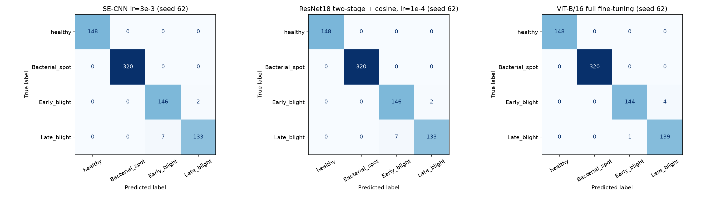
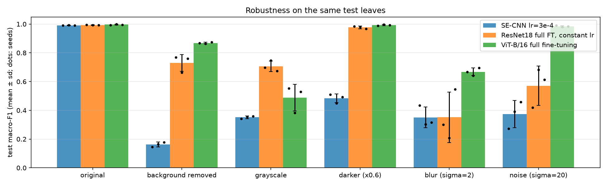
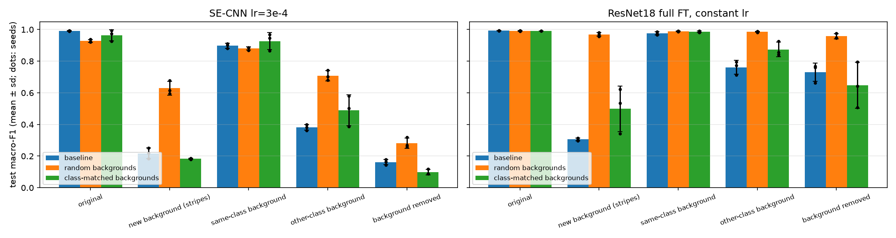

## 1. Motivation

Plant diseases cause large crop losses, and a phone photo of a leaf is the cheapest possible diagnostic. PlantVillage made this a popular deep-learning benchmark, and models routinely report accuracies above 99%. But PlantVillage photos are taken in controlled sessions, and **each class was photographed in its own photo series**: on its own table, under its own light. A model can therefore score highly by recognising the *background* instead of the disease (Noyan, 2022). Our project asks two questions:

1. How do a CNN trained from scratch, a fine-tuned ResNet18 and a fine-tuned Vision Transformer (ViT) compare on a leakage-free, leaf-grouped split? (minimum requirements + advanced direction 1)
2. **Why** are they accurate, and does that accuracy survive a change of background, colour, lighting, image quality or a move to field photos? (advanced direction 2, with interpretability from direction 3)

Our main finding is that all three models reach 99.1–99.7% test macro-F1, yet a classifier that sees **only the four image corners** already reaches 87%. Swapping the background of the same leaf breaks the models, and a simple background-replacement augmentation fixes most of this for ResNet18 at almost no cost in clean accuracy. It does not fix the gap to real field photos.

## 2. Data and Protocol

**Classes.** We use four tomato classes from `raw/color`: *healthy*, *Early blight*, *Leaf Mold* and *Spider mites* (two-spotted spider mite). We chose them because each has one photo series in which **every photo carries an official leaf id** in `leaf-map.json` (`RS_HL`, `RS_Erly.B`, `Crnl_L.Mold`, `Com.G_SpM_FL`). The leaf-group split then loses only one photo. The suggested *Late blight* class, by contrast, has 541 photos without a leaf id.

**Split.** Leaf ids of every class are split 70/15/15 into train/validation/test with split seed **62**. An audit checks that no leaf id appears in two splits. All photos of the same leaf, and all their augmented versions, therefore stay in one split. Training seeds (62, 63, 64) are separate from the split seed. The validation set is used for all tuning and model selection. The test set is used only once, for the final models.

| Class | Train | Val | Test | Total | Leaf ids |
|---|---:|---:|---:|---:|---:|
| healthy | 699 | 152 | 148 | 999 | 250 |
| Early blight | 699 | 152 | 148 | 999 | 250 |
| Leaf Mold | 668 | 144 | 140 | 952 | 238 |
| Spider mites | 1,172 | 252 | 252 | 1,676 | 419 |
| **All** | **3,238** | **700** | **688** | **4,626** | **1,157** |

*Table 1. Class counts per split (seed 62). Spider mites is the largest class (1.76× the smallest).*

**Label verification.** Labels come from the class folder. Each photo is matched only to a leaf-map entry *of its own class*, and the code asserts that every training photo has an official leaf id. Our SQLite exploration of the full dataset (`database/REPORT.md`) found no duplicate or near-duplicate image (dHash) across classes. File names are never used as model inputs: in that same exploration, the series code in the file name alone predicted the class with 89.7% accuracy.

**Preprocessing.** Every 256×256 photo is decoded once, resized to 224×224 (bilinear) and cached as a `uint8` tensor, so training reads no JPEGs. All splits are normalised with ImageNet statistics. **Training-only augmentation** uses horizontal/vertical flips, 90° rotations and ±10% brightness/contrast. These operations preserve the symptoms: they change neither lesion colour nor texture, and 90° rotations add no black corners. Validation and test images are only normalised.

**How much does the background alone tell?** A random forest trained on just the mean colour of the four 24×24-pixel image corners (12 numbers, no leaf pixels) reaches **88.1% accuracy / 0.868 macro-F1** on the validation set. Always predicting the largest class gives 36% / 0.132. The background is therefore a strong shortcut, and this motivates the robustness study in Section 5.

## 3. Methods

**SE-CNN (from scratch).** Four blocks of Conv3×3–BatchNorm–ReLU–MaxPool (32→64→128→256 channels, 224→14 px), global average pooling, dropout 0.3 and a linear classifier (0.41 M parameters). After each block, a **Squeeze-and-Excitation** block (Hu et al., 2018) learns per-channel attention weights from globally pooled features. This is a light form of the attention covered in Lab 5.

**ResNet18 (transfer learning).** ImageNet-pre-trained ResNet18 with a new 4-way head. We compared a frozen backbone, two-stage fine-tuning (1 head-only epoch at lr 1e-3, then all layers with a cosine schedule) and full fine-tuning from the start with a constant learning rate.

**ViT-B/16 (transformer).** ImageNet-pre-trained ViT-B/16 with a new head. Three epochs train only the head (lr 1e-3). After that, the head (lr 1e-4) and the unfrozen backbone (lr 1e-5) train for up to 12 more epochs. The setup uses AdamW (weight decay 0.01) and batch 16. We compare three strategies: **head only**, **partial** (last 2 encoder blocks + final LayerNorm) and **full fine-tuning**.

**Training.** All models use AdamW and cross-entropy. CNN and ResNet18 add inverse-frequency class weights. Mixed precision runs on CUDA. **Early stopping** has a patience of 5 epochs on validation macro-F1, and the best checkpoint is kept. Runs are deterministic: fixed seeds, `torch.use_deterministic_algorithms` and a cuDNN benchmark that is switched off. Every run saves its checkpoint, history and configuration, so interrupted notebooks resume without retraining.

**Evaluation protocol.** We report accuracy, macro-F1, per-class F1 and confusion matrices. Every final model is trained with **3 seeds** and reported as mean ± sample standard deviation. Two models trained with the same seed are compared **seed by seed** ("A better than B in k of 3 seeds"), so that seed noise is not mistaken for an effect.

## 4. Results on the Clean Test Set

### 4.1 Tuning and ablations (validation set)

We first ran one-factor-at-a-time ablations with seed 62: learning rate, batch size, dropout, augmentation, class weights and schedule for the CNN; freezing strategy, learning rate, batch size, augmentation and weight decay for ResNet18. We then **re-ran the top candidates with all three seeds** before selecting a model.

* **The validation set saturates.** Most ResNet18 variants reach 1.000 validation macro-F1. With 700 validation photos, one error moves macro-F1 by about 0.0015, so single-seed differences between the CNN ablations (0.990–1.000) are within seed noise. The CNN "full recipe" (lr 1e-3) scores 1.000 with seed 62 but 0.994 ± **0.010** over three seeds. The **multi-seed re-run is essential**. It selected **SE-CNN with lr 3e-4** (0.9982 ± 0.0015) because it is the most stable.
* The clearest single-seed effects were **removing the SE attention** (0.990 vs 1.000), **removing augmentation** (0.994) and **removing class weights** (0.993). All are consistent with the expected direction but small.
* For ResNet18, a **frozen backbone** is clearly worse (0.976). ImageNet features have to adapt to leaf textures. Full fine-tuning with a constant learning rate scored 1.000 in all three seeds and was selected.

### 4.2 ViT fine-tuning strategies

| ViT-B/16 strategy | Trainable params | Val macro-F1 | Test macro-F1 | Train time (s) | Peak mem (MiB) |
|---|---:|---:|---:|---:|---:|
| Head only | 3 k | 0.9889 ± 0.0019 | 0.9857 ± 0.0027 | 235 | 701 |
| Partial (last 2 blocks) | 14.2 M | 0.9982 ± 0.0008 | 0.9940 ± 0.0010 | 279 | 895 |
| Partial, no augmentation | 14.2 M | 0.9932 ± 0.0008 | 0.9937 ± 0.0016 | 205 | 895 |
| **Full fine-tuning** | 85.8 M | **1.0000 ± 0.0000** | **0.9966 ± 0.0031** | 295 | 2,556 |

*Table 2. ViT strategies (3 seeds). Test scores are shown for analysis only; selection used validation.*

Unfreezing more of the network helps consistently. Partial beats head-only by +0.008 macro-F1 in **3 of 3 seeds**, and full beats partial by +0.003, also in 3 of 3 seeds. Full fine-tuning needs 2.9× the peak memory of partial fine-tuning but converges in fewer epochs (best epochs 4–5), so its total training time is only 6% higher. Augmentation had **no measurable effect** on the ViT (+0.0003, better in 2 of 3 seeds). Large-scale pre-training already provides the invariances that flips and small jitters add.

### 4.3 Final comparison, errors and class imbalance

| Model | Accuracy | Macro-F1 | F1 healthy | F1 Early blight | F1 Leaf Mold | F1 Spider mites |
|---|---:|---:|---:|---:|---:|---:|
| SE-CNN (scratch) | 0.9908 ± 0.0017 | 0.9910 ± 0.0016 | 0.999 | 0.985 | 0.990 | 0.990 |
| ResNet18 (full FT) | 0.9927 ± 0.0015 | 0.9931 ± 0.0014 | 1.000 | 0.985 | 0.996 | 0.991 |
| ViT-B/16 (full FT) | **0.9966 ± 0.0030** | **0.9966 ± 0.0031** | 1.000 | 0.993 | 0.997 | 0.997 |

*Table 3. Test results (688 photos, mean ± sd over seeds 62–64).*

{width=100%}

The ranking ViT > ResNet18 > SE-CNN holds, but the gaps are small: on average 6.3, 5.0 and 2.3 errors out of 688 photos. **Errors concentrate on Early blight ↔ Spider mites.** Both produce speckled, discoloured leaf surfaces, and Early blight has the lowest F1 for every model. *Healthy* is almost never confused. Errors that recur **in every seed** (1 for the SE-CNN, 3 for ResNet18, 0 for the ViT) point to a few genuinely ambiguous leaves rather than random failures.

**Class imbalance** is mild (1.76:1) and does not drive the errors. The largest class, Spider mites, does not dominate the predictions. The smallest class, Leaf Mold, has *higher* F1 than Early blight. Removing the class weights cost the CNN only 0.007 validation macro-F1 with one seed. The errors reflect **visual similarity, not class frequency**.

### 4.4 Compute trade-offs

| Model | Params | Size | Latency bs=1 | ms/img bs=64 | Epochs | Train time | Peak mem |
|---|---:|---:|---:|---:|---:|---:|---:|
| SE-CNN | 0.41 M | 1.7 MB | 1.1 ms | 0.36 | 24.7 | 142 s | 848 MiB |
| ResNet18 | 11.2 M | 44.8 MB | 3.1 ms | 0.38 | 10.3 | **59 s** | 595 MiB |
| ViT-B/16 | 85.8 M | 343 MB | 8.5 ms | 2.57 | 9.3 | 295 s | 2,556 MiB |

*Table 4. Inference (CUDA GPU) and training cost (means over 3 seeds, training time excludes validation).*

The ViT's +0.35 percentage points over ResNet18 cost 7.7× the parameters, 6.7× the batched inference time and 5× the training time. **ResNet18 is the best accuracy-per-cost model.** Pre-trained features make it converge in about 10 epochs, so it trains faster than the from-scratch CNN, which is 27× smaller. The SE-CNN is the best option for very constrained devices (1.7 MB). Its peak training memory exceeds that of ResNet18 because it keeps full-resolution 32-channel feature maps, whereas ResNet18 downsamples with a strided stem.

## 5. Robustness: Does the Model Look at the Leaf?

### 5.1 Same test leaves, different conditions

We evaluate the final models (trained on colour photos) on the **same 688 test leaves** under five changes: background removed (PlantVillage's segmented version), grayscale, darker (×0.6), Gaussian blur (σ=2) and Gaussian noise (σ=20).

{width=100%}

All models degrade sharply. The **SE-CNN collapses to near chance under every change** (0.16–0.48). Pre-training helps a lot: the ViT is almost immune to darkening (0.993) and noise (0.985). The weaknesses differ by architecture, though. ResNet18 handles grayscale best (0.71 vs 0.49 for the ViT), and both pre-trained models fail under blur. **Removing the background** costs ResNet18 26 points and the ViT 13 points. This is the first sign of the background shortcut.

**Is the drop caused by the shift, or by missing information?** We retrained the ViT on grayscale and on background-removed photos with the same split. Each model then scores 0.987 and 0.998 on its own input type. Colour and background are therefore *not needed* for the task. Colour-trained models are fragile because they *learned to use* these cues, not because the cues are necessary. Training on background-removed photos also transfers well to the originals (0.956), while the colour-trained ViT reaches only 0.869 on background-removed photos.

### 5.2 Same leaf, other background

To separate leaf from background directly, we pasted each test leaf (using its segmentation mask) onto a leaf-free corner tile from another test photo. That photo came either from the **same class** or from **another class**.

| Model | Original | Same-class background | Other-class background | Prediction = class of the background |
|---|---:|---:|---:|---:|
| SE-CNN | 0.991 | 0.897 | **0.381** | **45.4%** |
| ResNet18 | 0.993 | 0.976 | 0.761 | 15.6% |
| ViT-B/16 | 0.997 | 0.922 | 0.771 | 12.4% |

*Table 5. Macro-F1 for the same leaves on swapped backgrounds (3 seeds; all differences hold in 3 of 3 seeds).*

The pasting itself costs only 2–9 points (same-class column). An *other-class* background, however, costs 23–61 points, and the **SE-CNN follows the background more often than the leaf**. Grad-CAM (Selvaraju et al., 2017) confirms this. Only **40%** of the SE-CNN's Grad-CAM mass falls on the leaf, which covers 38% of the image. In other words, it attends uniformly and has no leaf preference. ResNet18 puts 56% on the leaf.

### 5.3 Countermeasure: training with random backgrounds

With probability 0.5, we replace everything outside the leaf mask of a training photo with a random background: black, a solid colour, a gradient, smooth noise or a corner tile from any training photo. As a **control**, we train the same models with **class-matched** backgrounds (tiles from the same class). The control applies the same amount of pasting but keeps the shortcut.

{width=100%}

* **ResNet18 + random backgrounds becomes background-invariant.** Other-class background goes from 0.761 to **0.986**, an unseen striped background from 0.305 to **0.969**, and background removed from 0.730 to **0.957**, each better in 3 of 3 seeds. Predictions that follow the background drop from 15.6% to **0.5%**. The leaf share of Grad-CAM rises from 56% to 66%. Clean macro-F1 changes by only −0.002, which is not significant.
* The **class-matched control** helps much less (stripes 0.499, background removed 0.648). The gain therefore comes from **breaking the background–label correlation**, not from the pasting augmentation itself.
* The **SE-CNN** improves too (other-class background 0.381 → 0.708). It pays for this with 6 points of clean macro-F1 (worse in 3 of 3 seeds). A small network trained from scratch lacks the capacity or the prior to learn leaf features as well as the shortcut was learned.

### 5.4 Beyond controlled photographs

**PlantDoc field photos** (Singh et al., 2020; 244 cropped leaves from the matching folders). All models fail: macro-F1 is 0.17–0.22 for the three final models and at most **0.28** (SE-CNN + random backgrounds). Almost every field photo is predicted as *Early blight*. Early blight recall is 0.95–1.00, while healthy recall stays below 0.09. Real field images contain clutter, multiple leaves, shadows and different cameras, and none of this appears in PlantVillage. The PlantDoc spider-mite folder holds only two photos, so its recall is not meaningful.

### 5.5 Do the models know when they are wrong?

On clean test photos, the models are well calibrated: expected calibration error (ECE) ≤ 0.01. The 5% least-confident predictions contain 85–100% of all errors, so abstaining on 5% of photos raises accuracy to 99.9–100%. **Under shift this breaks down.** For example, the SE-CNN on background-removed photos has an ECE of 0.70, and its 5% least-confident predictions contain only 5% of the errors. The models are confidently wrong, so confidence thresholds cannot detect out-of-distribution photos.

## 6. Discussion and Limitations

**What we learned.** (1) A >99% PlantVillage accuracy says little about whether a model has learned the disease. A corner-pixel baseline gets 87%, and swapping backgrounds exposes the shortcut. (2) Transfer learning matters more for **robustness** than for clean accuracy: the from-scratch CNN is only 0.2 points behind ResNet18 on the clean test, but 35–57 points behind under background removal, grayscale and darkening. (3) The ViT is the most accurate and the most robust to lighting and noise. It costs about 5–7× more compute than ResNet18, and its grayscale robustness is lower. (4) **Targeted augmentation that breaks a known shortcut** (random backgrounds) works, and the class-matched control proves why. Generic augmentation (flips/jitter) had no measurable effect for the pre-trained models. (5) None of this closes the **lab-to-field gap**. That gap needs field training data, not just augmentation.

**Limitations.** Every class was photographed under controlled conditions, so disease, background, camera and light are confounded. No split of this data can remove that confound, and only the tests in Section 5 can probe it. The three seeds cover training randomness on **one fixed split**, not the choice of test leaves. Validation scores saturate, which limits how finely hyperparameters can be ranked. Background removal relies on PlantVillage's own segmentation, which sometimes cuts away leaf edges. The field test covers only three of our four classes meaningfully.

**Course connections.** The project uses CNNs, batch normalisation and dropout (Labs 2–3), transfer learning and fine-tuning schedules, attention (SE) and Transformers (Lab 5), and evaluation methodology (held-out test, macro-F1, calibration).

## 7. Contribution of Each Group Member

| Member (Student ID) | Contribution |
|---|---|
| [Name] ([ID]) | *e.g. data pipeline: download, leaf grouping, leaf-group split and leakage audit, image cache, background-only baseline; PlantVillage database exploration* |
| [Name] ([ID]) | *e.g. SE-CNN and ResNet18 implementation, training engine, tuning and ablations* |
| Zhouyang ([ID]) | *ViT-B/16 fine-tuning protocol and strategies; input (grayscale/background-removed) ablation* |
| [Name] ([ID]) | *e.g. test evaluation, compute trade-offs, error analysis, Grad-CAM* |
| [Name] ([ID]) | *e.g. robustness tests, background swap, countermeasure and PlantDoc* |
| [Name] ([ID]) | *e.g. report, presentation, figures, README* |

## Acknowledgements and References

**Software:** PyTorch and torchvision (models, ImageNet weights of ResNet18 and ViT-B/16, transforms), scikit-learn, SciPy, NumPy, pandas and Matplotlib.

1. Hughes, D. P., & Salathé, M. (2015). An open access repository of images on plant health to enable the development of mobile disease diagnostics. *arXiv:1511.08060*.
2. Mohanty, S. P., Hughes, D. P., & Salathé, M. (2016). Using deep learning for image-based plant disease detection. *Frontiers in Plant Science*, 7, 1419.
3. Singh, D., et al. (2020). PlantDoc: A dataset for visual plant disease detection. *CoDS-COMAD 2020*.
4. Noyan, M. A. (2022). Uncovering bias in the PlantVillage dataset. *arXiv:2206.04374*.
5. He, K., Zhang, X., Ren, S., & Sun, J. (2016). Deep residual learning for image recognition. *CVPR*.
6. Hu, J., Shen, L., & Sun, G. (2018). Squeeze-and-excitation networks. *CVPR*.
7. Dosovitskiy, A., et al. (2021). An image is worth 16×16 words: Transformers for image recognition at scale. *ICLR*.
8. Selvaraju, R. R., et al. (2017). Grad-CAM: Visual explanations from deep networks via gradient-based localization. *ICCV*.
9. Guo, C., Pleiss, G., Sun, Y., & Weinberger, K. Q. (2017). On calibration of modern neural networks. *ICML*.
